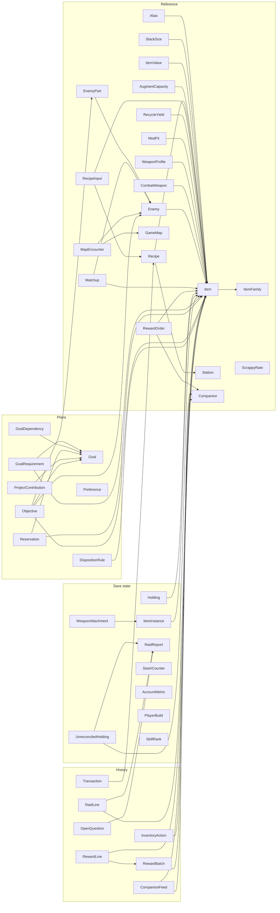
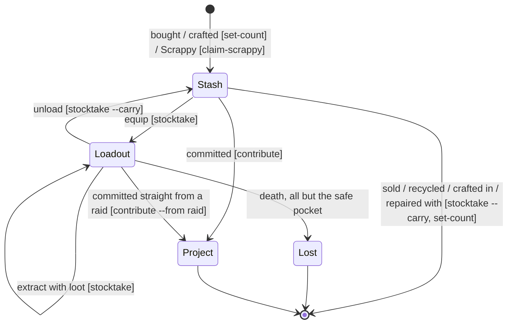

# First principles

Read this before changing the model. It has three parts, held to different standards:

- **A. System principles**: how this package reasons. Exact; they are design decisions.
- **B. Building blocks and how they interact**: the objects, their links, and how each one
  changes over time. Exact; they describe the code.
- **C. Game rules**: how ARC Raiders itself moves items around. Each rule carries its source and
  status. Nothing here is from memory. Frozen Trail 2.0 (8 Oct 2026) changed the game, so any
  source older than that is marked as such.

---

## A. System principles

**A1. We store observations, not state.** Every value is something a player saw (or a sourced
reference fact), attached to a `Source` with a date and a `seq`. `seq` is the proven write order.
"Current state" is the latest observation of each fact.

**A2. Unknown is not zero, and absent is not none.** A blank quantity means "not observed"; `0`
means "observed: none". An item with no rows at all is unknown, never "you have none". Only a
complete count proves a zero (a stocktake zeroes what it did not see).

**A3. One fact, one place.** If a value can be derived, it is computed and never stored. Coin
savings progress is the coin metric; slot use comes from counts and stack sizes; whether a count
came after a raid comes from `seq`. Every legacy drift bug was one fact stored twice.

**A4. A quantity's location must be proven.** If the records cannot say where something is, it
goes into `unreconciled_holdings`, outside confirmed totals and plans until a live count closes
it. Closing a row needs a count for every location it claims; a slot is never assumed empty.

**A5. Three independent measurements must agree.** The stash slot counter (e.g. `212/232`), the
item counts, and the coins are each read off the game separately. With stack sizes known, counts
imply the slots (`slot_math`, merged stacks), and sales imply the coins. A stocktake refuses
unless counts reproduce the counter exactly. Each action is saved as it is reported (`arc loot`,
`sell`, `craft`, `move`, ...) and checked against the counter on the spot, so a missing input is
caught where it happened. `arc expect` states both before the player reads them. Agreement proves nothing was skipped; disagreement is A9.

**A6. Four layers that never leak into each other.**

| Layer | What it is | Example |
| --- | --- | --- |
| Reference | Game facts, sourced | a recipe, a stack size, an augment's slots, Scrappy's rates |
| Save state | What the player has now | holdings, pieces, stash counter, coins, build |
| Plans | What the player intends | goals, standing keep/sell rules, reservations |
| History | What happened | raid receipts, sales, crafts, reward batches |

A plan never changes ownership. History is never replayed to recompute state.

**A7. Every write is a transaction.** It takes the lock, records the player's words as a new
`Source`, applies a typed change, runs every rule over the whole graph, and refuses on any ERROR
without writing anything. Then it swaps the data in atomically and makes a git commit naming the
actor. A write path that skips any of these steps is a bug.

**A8. Inference is labeled.** Weapon-vs-enemy rankings are `tactical_inference`. Estimates
never sit in a field that looks like a measurement.

**A9. A residual is a message.** If a live count disagrees with the records or a prediction, an
input is missing (a sale, a death, a pickup, a price). Record the live count, say what is
unexplained, and never adjust a number until it fits.

**A10. Sources rank.** When two sources disagree, the higher one wins and the lower one is kept
as a note: the player's in-game reading, then the official patch notes, then the wiki, then the
community dataset, then third-party guides. A reading is dated, because patches change facts
(2.0 moved costs); re-read before relying on an old one. Imports never overwrite a higher rank.

**A11. A tracked piece keeps its identity.** A weapon, shield or gadget with its own durability is
one `ItemInstance` for life. Moving it changes its location, attached mods travel with it, and an
upgrade changes its item while keeping the piece and its mods. Pieces are never deleted and
re-created to model a move.

**A12. Numbers come from the screen, decisions from the voice.** Players talk to the agent by
voice, and voice transcription mishears numbers. Counts and durabilities are taken from
screenshots or read back one item at a time; anything heard is repeated back before saving. A
count that is physically impossible (more stacks than slots, a pocket over its size) is asked
about, never guessed.

**A13. Game facts are shareable; a player's records are not.** Reference tables travel to other
players (`arc export-starter`); save state, plans, history, preferences and the words in sources
stay private. Exports renumber source ids, which can encode a player's numbers.

---

## B. Building blocks and how they interact

### B1. The object map

Arrows point from a row to the object it references (stored as `<field>_id`, resolved on load).
`Source` is referenced by almost everything and is left out for readability.



`Item` is the hub. Almost every question ("can I craft X", "what does goal Y still need", "is
this safe to sell", "how many slots will this take") is a walk from an `Item` through these edges.

### B2. The three kinds of inventory row

| Row | Meaning | Counts toward |
| --- | --- | --- |
| `Holding` | a fungible stack, one per (item, location), with its slot count | confirmed total; stash for planning |
| `ItemInstance` | one physical piece with its own durability or attachments | confirmed total (1 each); one slot unless attached |
| `UnreconciledHolding` | a recorded quantity whose location is unproven | only `recorded` (the parity check), never plans |

`Balance` combines them for one item: `confirmed` = holdings + instances; `stash` = the stash
part; `recorded` = everything.

### B3. How objects change over time

**Where an item can be**, with the commands that record each move:



"Loadout" covers `equipment`, `backpack`, `quick_use` and `safe_pocket`; `carried` remains only
for legacy totals whose split was never reported. Loot stays in the loadout until the player
unloads it by hand.

**State machines with rules that enforce them:**

| Object | States | Transition | Enforced by |
| --- | --- | --- | --- |
| Stash count | recorded → re-counted | counts must reproduce the counter slot for slot | `stocktake`; rule `stack_physics` |
| `ItemInstance` | stash ⇄ loadout; tier N → N+1 | moves keep id and mods; an upgrade keeps the piece and records new durability | `stocktake`, `upgrade`; rule `attachments_fit` |
| `WeaponAttachment` | attached ⇄ loose | a loose mod takes its own slot; one mod per slot; the fit must be known | `attach-mod`, `detach-mod`; rule `attachments_fit` |
| `ItemInstance` durability | current/max/source set together | 0 ≤ current ≤ max | `set-condition`, `stocktake`; rule `instance_condition` |
| Loadout | any | stacks per carried slot within the equipped augment's limits | rule `loadout_capacity` |
| `Goal` | `deferred` / `active` / `blocked` → `complete` | completing releases its reservations | `set-goal-status`; rule `reservations` |
| `ProjectContribution` | grows | never above the requirement; never returns to inventory | `contribute`; rule `contributions` |
| `RewardBatch` | `claimed` | Scrappy's haul enters the stash once, explained against `ScrappyRate` | `claim-scrappy` |
| `CompanionFeed` | `queued` → `consumed` | food leaves the stash when queued; +5 of its material when eaten | `feed-scrappy`, `claim-scrappy --ate` |
| `UnreconciledHolding` | exists → removed | live counts for stash and every claimed slot | `reconcile`, `stocktake` |
| `OpenQuestion` | `open` → `resolved` | the answer is its own `resolution` source | `resolve-question` |

### B4. Conservation, checked at every raid

For each item, the change between two counts is explained by events:

```text
after = before + loot + crafted + rewards + bought − sold − recycled − crafted_in − repaired_with
        − consumed − lost_on_death − contributed
```

Checked two ways. **Before saving**, `arc expect` applies a raid's changes to the records and
states the stash counter and coins the player should see; `stocktake --carry` saves only if the
counter matches. **Per item**, every stocktake that counts the stash records the reported
changes as `inventory_actions` (`loot`, `sell`, `used`) and compares each item's live total
across the counted places with records plus those events. A difference is a `residual`: recorded
with its sign and named in the result ("residual: light_ammo +8"), never absorbed (A9). Moves
between counted places net to zero; a first observation of an item is never a residual (A2).

### B5. Rules enforced on every write

`checks.py`, one function each: `source_order`, `one_stack_per_location`, `single_singletons`,
`stash_counter`, `nonnegative_quantities`, `instance_condition`, `attachments_fit`, `goal_graph`,
`contributions`, `reservations`, `objectives_typed`, `bounded_progress`, `inference_labeled`,
`one_price_per_item`, `unique_names`, `stack_physics`, `loadout_capacity`, `unreconciled_loot`
(WARN), `carried_locations_sane` (WARN).

---

## C. Game rules

Status key:

- **official 2.0**: Embark's Frozen Trail 2.0 notes (8 Oct 2026).
- **wiki**: community wiki. Not confirmed to match 2.0 unless stated.
- **guide**: third-party guide. Weaker.
- **player**: observed in game. **This outranks the others when they disagree** (A10).
- **unsourced**: needs a source or a player observation before anything relies on it.

### C1. Death

| Rule | Status | Source |
| --- | --- | --- |
| On death you lose everything carried except the safe-pocket contents | guide (pre-2.0); no 2.0 change found | [Epic Games guide](https://store.epicgames.com/news/arc-raiders-guide-12-tips-help-survive-rust-belt) |
| Weapons cannot go in the safe pocket, except with Looting Mk. 3 (Safekeeper), whose pocket holds any item | guide, wiki | [GamesRadar](https://www.gamesradar.com/games/third-person-shooter/arc-raiders-answers-the-communitys-prayers-new-epic-looting-augment-lets-you-put-weapons-in-your-safe-pocket-and-even-use-heavy-shields-to-boot/), [wiki: Augments](https://arcraiders.wiki/wiki/Augments) |
| Quest items in the safe pocket keep their quest status after death | guide | [blast.tv](https://blast.tv/gaming/news/arc-raiders-put-this-in-your-safe-pocket) |
| A downed player's weapon can be looted along with its stencil | official 2.0 | [Frozen Trail 2.0](https://arcraiders.com/news/frozen-trail-2-0-update) |
| Augments lose 30 durability when the wearer is knocked out | wiki | [wiki: Augments](https://arcraiders.wiki/wiki/Augments) |

### C2. Loadout capacity (by augment)

From [wiki: Augments](https://arcraiders.wiki/wiki/Augments). The 2.0 notes add Epic augments to
Apollo's offers but list no slot changes.

| Augment | Weight | Slots | Quick use | Safe pocket | Other |
| --- | --- | --- | --- | --- | --- |
| Free Loadout | 35 | 14 | 4 | **0** | |
| Looting Mk. 1 | 50 | 18 | 4 | 1 | |
| **Looting Mk. 2** | 60 | 22 | 4 | **2** | 3 trinket |
| Looting Mk. 3 (Cautious) | 70 | 24 | 5 | 2 | binoculars |
| Looting Mk. 3 (Safekeeper) | 65 | 18 | 4 | 1 (any item) | 2 trinket |
| Looting Mk. 3 (Survivor) | 80 | 20 | 5 | 3 | 1 deployable |
| Combat Mk. 1 / 2 | 45 / 55 | 16 / 18 | 4 | 1 | Mk. 2: 1 grenade |
| Tactical Mk. 1 / 2 | 40 / 45 | 15 / 17 | 5 | 1 | |

Rest of the table (Mk. 3 variants) is on the wiki page. Each safe-pocket slot holds one item or
one stack ([blast.tv](https://blast.tv/gaming/news/arc-raiders-put-this-in-your-safe-pocket)).
Going Topside with no loadout gives 10 backpack slots and one safe pocket
([wiki: Loadout](https://arcraiders.wiki/wiki/Loadout)). Choosing a free loadout moves your
custom loadout back to the stash; it is refused if the stash is full (wiki: Loadout).

**Consequence:** the equipped augment's limits are enforced on every write (rule
`loadout_capacity`, table `augment_capacities`): with Looting Mk. 2, at most 22 backpack stacks,
4 quick-use stacks and 2 safe-pocket stacks.

### C3. Stash

| Rule | Status | Source |
| --- | --- | --- |
| 64 slots at level 1; +24 per level | wiki | [wiki: Stash](https://arcraiders.wiki/wiki/Stash) |
| Maximum 328 slots, excluding Expedition rewards and Nomadic Envoy space | **official 2.0** | [Frozen Trail 2.0](https://arcraiders.com/news/frozen-trail-2-0-update) |
| +12 slots per completed Expedition | wiki | wiki: Stash |
| Upgrade 232 → 256 costs **150,000** | **player** (`next_stash_expansion_cost`) | a player's in-game reading |
| Upgrade 256 → 280 costs **300,000** | **player**, 25 Oct 2026 | the pre-2.0 guide says 200,000; my 1.5x estimate (231k) was wrong |
| ...which conflicts with 130,000 on the wiki and GameBrief | wiki (pre-2.0 table) | [GameBrief](https://www.gamebrief.net/arc-raiders/arc-raiders-stash-size-guide-2026) |
| Levels 11–12 cost 750,000 / 1,500,000 | player-reported elsewhere, unofficial | GameBrief |

| Pre-2.0 table, 64 → 280 | guide | 5k, 10k, 15k, 25k, 40k, 60k, 90k, 130k, 200k per level ([allthings.how](https://allthings.how/arc-raiders-stash-size-limits-and-how-to-manage-them/)) |
| 208 → 232 cost 100,000 | **player** recollection | the guide says 90,000 |

The costs are a hand-set table, not a formula: each level is roughly 1.4–1.6x the last, then
the two 2.0 levels jump to 750k and 1.5M. The player's readings (100k, 150k) run above the
pre-2.0 guide (90k, 130k), consistent with a 2.0 price rise. The 256 → 280 step reads 300,000, double the last, so ratios from the old table do not
predict 2.0 prices. Read each price on the screen; never plan against a guessed one.

### C4. Stacks and slots

| Rule | Status |
| --- | --- |
| One stash slot holds one stack of one item | guide ([blast.tv](https://blast.tv/gaming/news/arc-raiders-put-this-in-your-safe-pocket), stated for the safe pocket) |
| Stack size per item | `stack_sizes`: community dataset (pre-2.0), outranked by in-game tooltips (`x/max`) and by merged stacks, where two equal stacks prove the limit |

### C5. Recycling and salvaging

| Rule | Status | Source |
| --- | --- | --- |
| Recycling in Speranza yields more than salvaging in a raid (e.g. Synthetic Resin: 14 vs 8 Plastic Parts) | guide | [allthings.how](https://allthings.how/arc-raiders-synthetic-resin-locations-and-when-to-recycle-it/) |
| The in-game confirmation panel shows exact outputs before confirming | guide | same |
| Per-item yields in `recycle_yields` | wiki, checked 19 Oct 2026 (post-2.0) | legacy sources |
| Anvil Splitter no longer drops; existing ones recycle into Amplified Fragments | **official 2.0** | Frozen Trail 2.0 |

`recycle_yields` should be read as **Speranza** recycling. Salvage yields are not recorded.

### C6. Scrappy

| Rule | Status | Source |
| --- | --- | --- |
| Stores rewards from up to 5 rounds, then must be emptied | wiki (modified 12 Oct 2026; no 2.0 mention) | [wiki: Scrappy](https://arcraiders.wiki/wiki/Scrappy) |
| Rewards need ≥1 minute in round, cap at 15 minutes, and depend on level and extraction | wiki | same |
| Feeding: queue up to 6 foods; each gives a flat +5 of its material, eaten after ≥6 minutes in a round | wiki | same |
| Expeditions 1/2/3 add +6% / +12% / +18%; fractions rounded down at collection | wiki | same |
| Level 3 rates in `scrappy_rates` | wiki, checked 19 Oct 2026 | legacy sources |

### C7. Reward Pass and feats

| Rule | Status |
| --- | --- |
| Feats give 15 / 25 / 50 Reward Points (easy / medium / hard); weekly milestones give 250 | **official 2.0**. Player-recorded feat rewards match exactly. |
| Cred was replaced by Reward Points; one pass active at a time; Frozen Trail Pass has 60 levels | **official 2.0** |
| Quests and objectives now grant XP; some older quests need photos from the new camera | **official 2.0** |

### C8. Durability and repair

| Rule | Status |
| --- | --- |
| Heavy Shield decay 0.20 → 0.15; movement penalty 15% → 10% | official 2.0 |
| Snap Hook durability use 2% → 4% per use; range 20 m → 18 m | official 2.0 |
| Field Repair may be unavailable after unlocking until restart; fixed in 2.1.0 | official 2.0 (known issue); [2.1.0 notes](https://thearcraiders.com/news/patch-2-1-0/) |
| Repair material costs per item | **unsourced**. `repair_input` actions are recorded, but no cost table exists. |

### C9. 2.0 changes that touch common plans

| Change | Status | Touches |
| --- | --- | --- |
| Tian Wen no longer sells Anvil and Hullcracker; they rotate weekly through Nomadic Envoys | official 2.0 | Anvil and Hullcracker plans. Crafting from a learned blueprint is unaffected by this note. |
| Anvil rarity Green → Blue; Bantam is the new uncommon hand cannon; Anvil's Tech Mod slot removed | official 2.0 | `combat_weapons` Anvil row |
| Launcher Ammo and Energy Clips have a daily purchase limit | official 2.0 | launcher ammo stockpiles |
| Weapon stencils need Stencil Parts found Topside | official 2.0 | whether to keep Stencil Parts |
| Shani's offers are coin-based; Ermal replaced by Cassio (valuables) | official 2.0 | sale planning |
| Hotfix 2.1.1 (16 Oct) fixed item duplication and locked-room access | [GameWatcher](https://www.gamewatcher.com/arc-raiders-patch-notes-and-roadmap-of-updates) | none directly |
| Store Update 2.2.0 (20 Oct) removed the Expedition Vault tab | guide ([GameBrief](https://www.gamebrief.net/arc-raiders/arc-raiders-loot-guide-what-to-keep-sell-scrap)) | none directly |

### C10. Workshop upgrades

Bench costs for levels I–III are on [wiki: Workshop](https://arcraiders.wiki/wiki/Workshop) (edited
10 Oct 2026, after 2.0) and are the starter goals in `starter.py`.

| Rule | Status | Source |
| --- | --- | --- |
| No bench needs the Outpost to reach level III; level III is the top level for most benches | **player**, 23 Oct 2026 | outranks the Workshop page, which marks Refiner III as needing it |
| Refiner III costs 3 Motor, 10 ARC Circuitry, 6 Bombardier Cell | **player**, in game, 23 Oct 2026 | matches the wiki's costs |
| Levels above III (e.g. Gunsmith IV) need the Outpost | wiki, unconfirmed in game | wiki: Workshop. Edit as higher levels appear. |
| Research Station levels need the matching Outpost level | wiki, unconfirmed in game | wiki: Workshop |

### C11. Nomadic Envoy trades and projects

| Rule | Status | Source |
| --- | --- | --- |
| The Envoy sells weapons for **trade value**, paid in specific items, not coins: Anvil II for 20,000, Hullcracker II for 30,000 (offers rotate) | **player**, 23 Oct 2026 | official 2.0 says Anvil and Hullcracker rotate through the Envoys |
| For the Anvil II it accepted ARC drivers (Hornet Driver 1,000, Wasp Driver 640), Firefly Burner 1,000, Sentinel Firing Core 2,000, Spotter Relay 1,000, and weapons valued by durability (e.g. Anvil IV 130/130 at 13,000, Vulcano I 55/100 at 5,400, Renegade I 57/100 at 3,963, Ferro IV 130/130 at 2,900, Rattler II 88/110 at 2,399, Rattler I 68/100 at 1,175, Kettle III 38/120 at 930). It refused Vaporizer Regulators. | **player**, 23 Oct 2026 | values seen on the trade screen; they move with durability |
| Committing items to a project (e.g. Trophy Display) removes them from the stash for good; that is a way to clear space | **player** | |
| Trophy Display page 2: 10 Spotter Relays, 3 Expired Respirators, 20 Wasp Drivers, 15 Hornet Drivers, after page 1 (5 Surveyor Vaults) | **player**, 23 Oct 2026 | |
| Crafting a Photoelectric Cloak needs Utility Station III | **player** | |

### C12. Skills (after the Frozen Trail 2.0 overhaul)

From [wiki: Skills](https://arcraiders.wiki/wiki/Skills) (edited 12 Oct 2026, post-2.0). The wiki
says its values "were found through player testing; may not be completely accurate," and gives
almost **no per-rank numbers**. Treat every per-rank figure as unverified until a tooltip or a
test confirms it.

| Rule | Status | Source |
| --- | --- | --- |
| 1 skill point per level (76 from levels) plus up to 5 per completed Expedition | wiki | wiki: Skills |
| Small nodes need 1 point in the node before them; each tree's first large node needs 10 points in that tree, the second needs 30 (first pick) and 40 (second pick), choosing 2 of 3 | wiki | wiki: Skills |
| 2.0 removed 13 skills, including Survivor's Stamina, Unburdened Roll and Good As New | wiki | wiki: Skills |
| Three Deep Breaths (Conditioning, max 5): faster stamina recovery after an ability drains it. Triggered by dodge rolls, sprint rolls and melee, not plain sprinting; each point about -0.5 s off a ~5.5 s delay | effect: wiki; triggers and numbers: one guide, **unverified, maybe pre-2.0** | [U4N](https://www.u4n.com/news/arc-raiders-three-deep-breaths-skill-key-effects-mechanics.html) |
| Stubborn Mule (Conditioning, max 5): stamina regen less affected by over-encumbrance | wiki, no numbers | wiki: Skills |
| Broad Shoulders (Conditioning, max 5): +2 carry weight per point, up to +10 | wiki (player-tested) | wiki: Skills |
| Conditioning large node 1: Back On Your Feet (health regenerates while critically hurt, up to a limit) or Downed But Determined (+~6 s per point before collapsing, from 100 s) | wiki; "critically hurt" threshold **undefined** | wiki: Skills |
| Mobility large node 1: Vaults On Vaults On Vaults (vaulting free) or Effortless Roll (cheaper dodge rolls) | wiki | wiki: Skills |
| Survival large node 2 options include Field Repair: repair gear up to 30% durability in a round | wiki | wiki: Skills |
| Sturdy Ankles (Survival) max 5 | wiki | wiki: Skills |

To settle per-rank values: read the in-game tooltip (it often shows the number), or time a
before/after test, and record the result here as a player observation.

### C13. Repair and upgrade costs read in game

The game changes these between patches (2.0 moved the Anvil's costs up a tier), so each row is a
dated player reading. Re-check on the screen before relying on one; record a new reading when it
differs.

| Rule | Status | Source |
| --- | --- | --- |
| Photoelectric Cloak repair: 2 Speaker Components + 1 Advanced Electrical Component | **player**, 23 Oct 2026 | matches the RaidTheory dataset (restores 50%) |
| Photoelectric Cloak craft: 4 Speaker Components + 2 Advanced Electrical Components at Utility III | dataset (pre-2.0) | RaidTheory |
| Anvil II repair: 2 Heavy Gun Parts + 2 Advanced Mechanical Components | **player**, 23 Oct 2026 | outranks the dataset's pre-2.0 3 Mechanical + 3 Simple Gun Parts |
| Anvil II to III: 1 Advanced Mechanical Component + 1 Heavy Gun Part; +10 max durability, fire rate bonus 25% to 50%, dispersion recovery 6.25% to 12.5% | **player**, 23 Oct 2026 | matches wiki: Anvil (post-2.0) |
| Light Shield repair: 4 Plastic Parts (from 79 and from 60) | **player**, 23 Oct 2026 | |
| Anvil III repair: 3 Heavy Gun Parts + 2 Advanced Mechanical Components (69/120 to full) | **player**, 25 Oct 2026 | one Heavy Gun Part more than Anvil II |
| Light Shield repair from 15/100 needed two repairs (8 Plastic Parts); from 81/100, one | **player**, 25 Oct 2026 | |
| Upgrading a weapon fully restores its durability (Anvil II 91/110 became Anvil III 120/120) | **player**, 23 Oct 2026 | an upgrade doubles as a repair |
| Loadout weight capacity with Looting Mk. 2: 60 (unit not shown on screen) | **player**, 23 Oct 2026 | wiki: Augments lists weight 60 |

### C14. Open questions

Each needs a source or a player's observation before the model relies on it.

1. **When does Scrappy eat queued food?** The wiki says after 6 minutes in a round; the player has
   seen it pay out a raid or two later. Track with `feed-scrappy` and `claim-scrappy --ate`.
2. **How fast do weapons wear?** One reading: Anvil II lost 10 durability in a raid with an
   explosion, about 3 in raids with little firing. A few more raids give a rate.
3. **Item weights and encumbrance.** The Looting Mk. 2 limit is 60 (unit not shown); item weights
   are not recorded, so encumbrance is not predicted.
4. **Where loot is found.** No loot-location table yet; player finds (room and container)
   should be recorded when they happen.
5. **Did 2.0 change recipes and recycle yields** in the imported dataset? Known changes (Anvil,
   repair costs) are recorded as player readings; the rest is unchecked.
6. **Is the 150,000 stash price a 2.0 change?** The price is confirmed in game; the cause is not.

Answered since the first version: loot stays in the loadout until unloaded by hand; the equipped
augment is recorded (Looting Mk. 2) and its limits are enforced; stack sizes are known for every
stash item.
